# Deploying a Node.js App on AWS with ECR, ECS and a Load Balancer

A hands-on DevOps project that containerizes a Node.js to-do app with Docker, stores the image in **Amazon ECR**, runs it on **Amazon ECS**, and scales it behind an **Application Load Balancer**.

## Architecture

```
 EC2 (Ubuntu + Docker)        Amazon ECR            Amazon ECS (Node-app-cluster)
 ---------------------   push  -----------  pull   ---------------------------------
 build Node.js image  ------>  node-app    ------>  Task definition -> Service (2 tasks)
                                                              ^
                                                              |  port 8000
                                          Application Load Balancer + Target Group
                                                              ^
                                                           Users
```

## Tech stack

Node.js (Express, EJS) | Docker | AWS EC2 | Amazon ECR | Amazon ECS | Application Load Balancer | CloudWatch | IAM

## What I did

1. Launched an **EC2** instance, installed Docker, and built an image of the Node.js app.
2. Gave the IAM user the permissions needed to push to **ECR**.
3. Authenticated Docker to ECR and pushed the image.
4. Created an **ECS cluster** and a **task definition** that uses the ECR image.
5. Created an **ECS service** with 2 running tasks.
6. Added an **Application Load Balancer** and **target group** so traffic is spread across the tasks.
7. Checked logs and container metrics in **CloudWatch**.

## Commands used

```bash
# Authenticate Docker to ECR
aws ecr get-login-password --region ap-southeast-2 | \
  docker login --username AWS --password-stdin <account-id>.dkr.ecr.ap-southeast-2.amazonaws.com

# Build, tag and push
docker build -t node-app .
docker tag node-app:latest <account-id>.dkr.ecr.ap-southeast-2.amazonaws.com/node-app:latest
docker push <account-id>.dkr.ecr.ap-southeast-2.amazonaws.com/node-app:latest
```

## Screenshots

### EC2 instance used to build the image
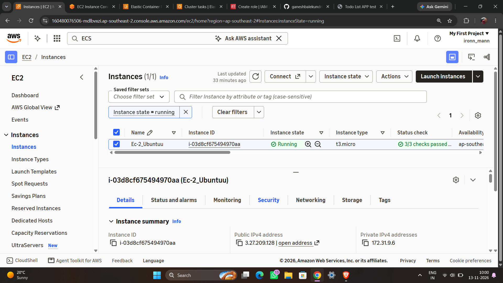

### IAM permissions for pushing to ECR
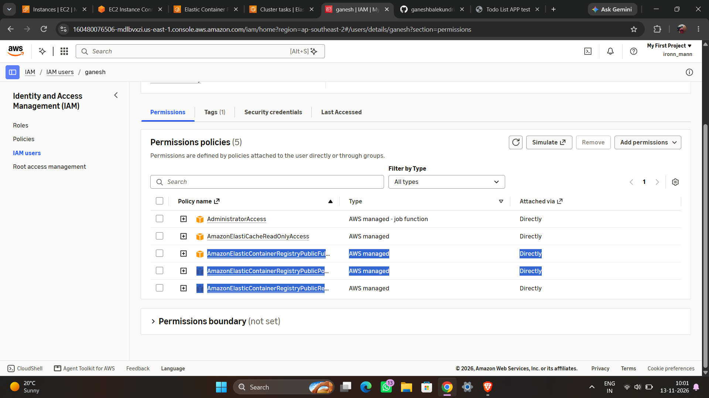

### ECR push commands
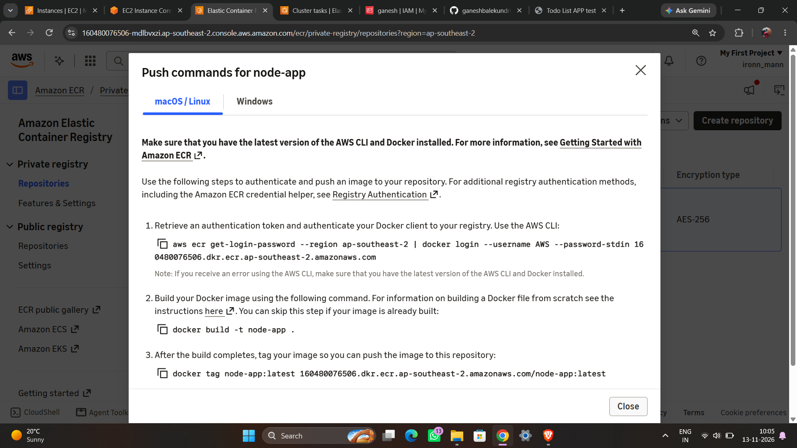

### Building the Docker image
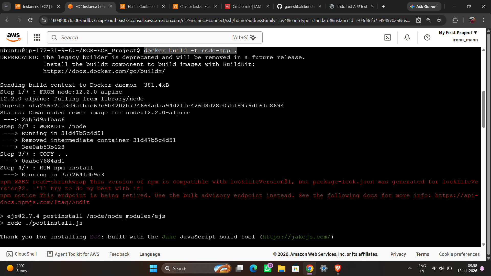

### Tagging the image
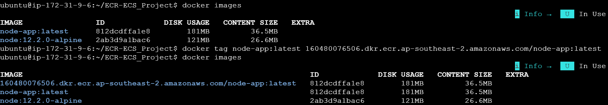

### Pushing the image to ECR
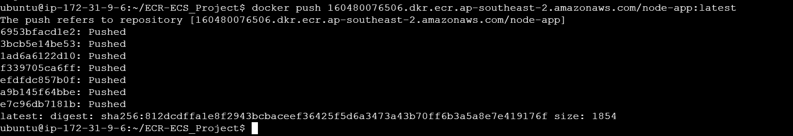

### Image stored in the ECR repository
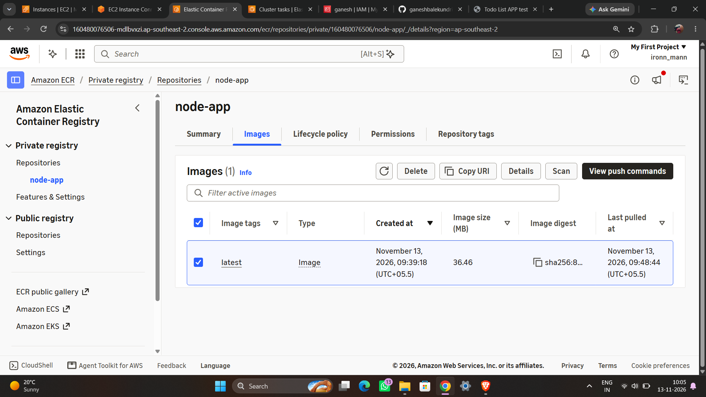

### ECS cluster
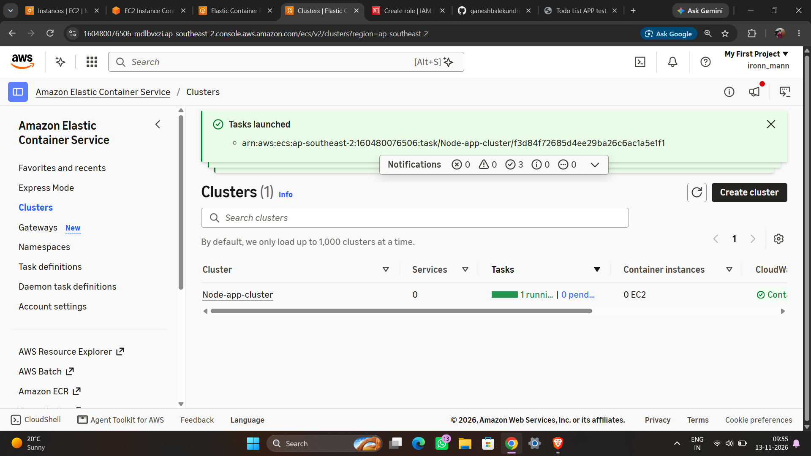

### ECS service with 2 running tasks
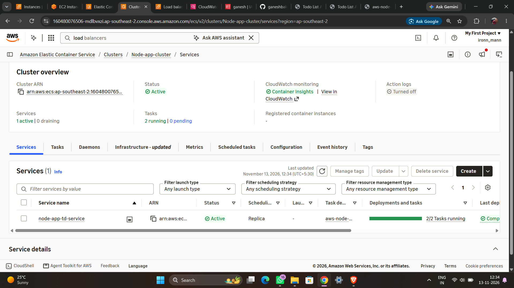

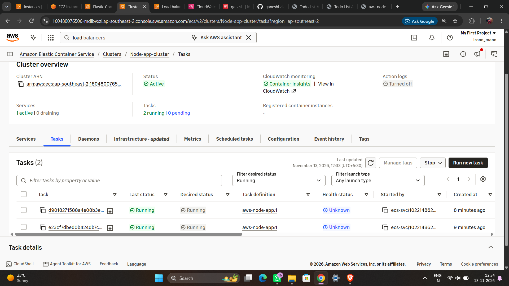

### Application Load Balancer
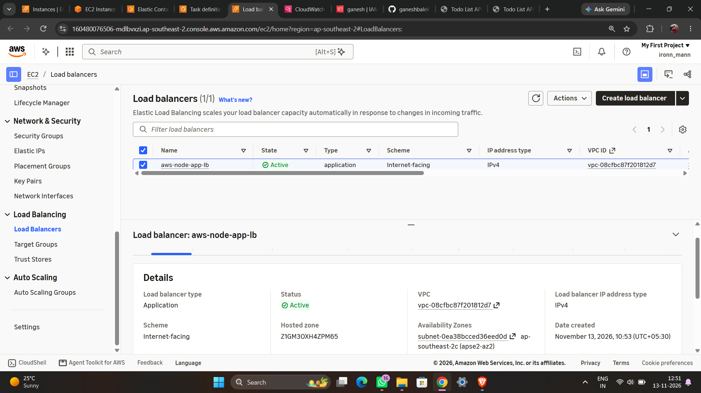

### Target group with healthy targets
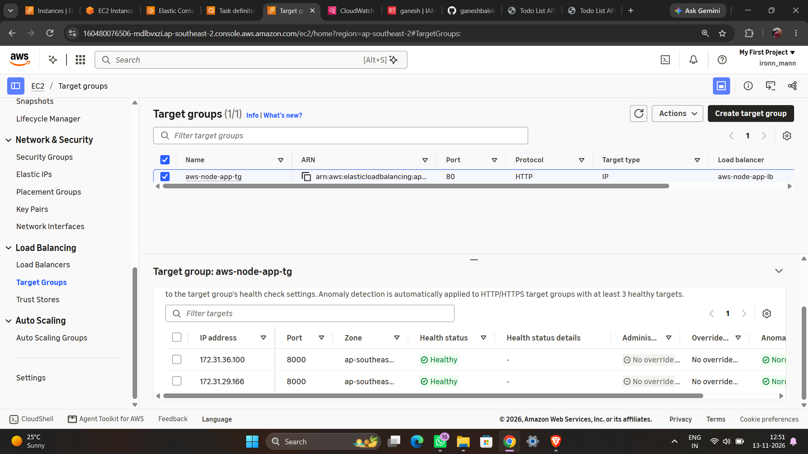

### CloudWatch log groups
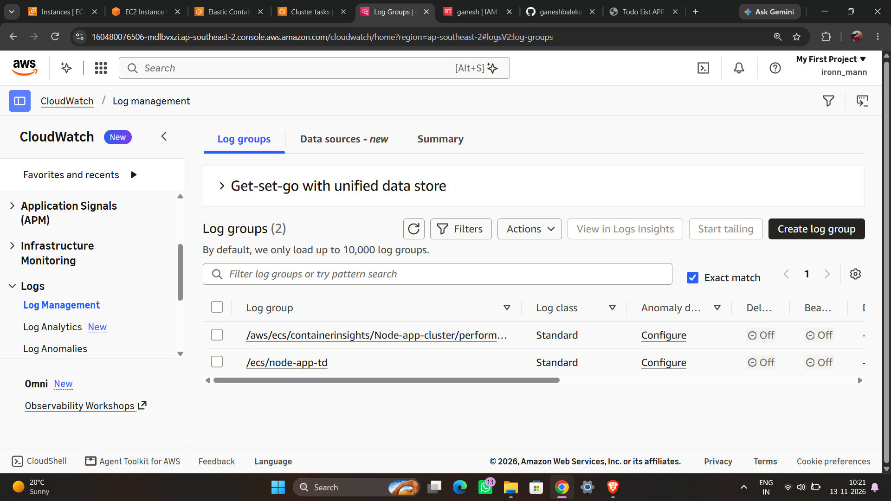

### The running application
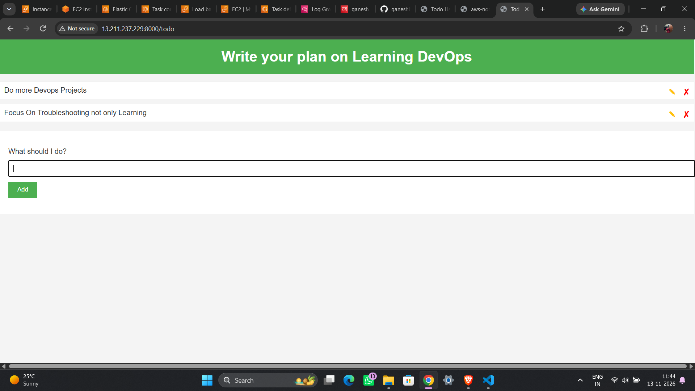

## Troubleshooting: tasks failing health checks

After the first deployment, the target group reported both targets as unhealthy with HTTP code `302`, and the service kept replacing tasks (container exit code 137) until the deployment rolled back.

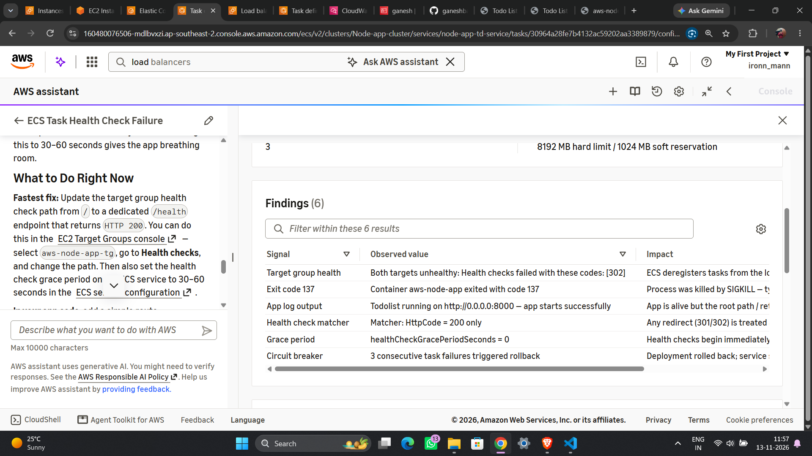

**Cause:** the load balancer health check requested `/`, but the app redirects that path to `/todo`. Only a `200` response counted as healthy, and the health check grace period was `0`, so tasks were killed before they were ready.

**Fix:** point the health check at a path that returns `200` (or accept `302` as a success code) and set a health check grace period on the service. The targets then became healthy.

## Key learnings

- The full container workflow: build, tag, push to a registry, pull and run on ECS.
- How task definitions, services and tasks relate to each other in ECS.
- How an Application Load Balancer and target group spread traffic and decide which tasks are healthy.
- How to read ECS service events and target group health to debug failed deployments.

## Possible improvements

- Upgrade the base image from `node:12.2.0-alpine` (no longer supported) to a current Node LTS image.
- Use a least-privilege IAM policy for ECR instead of broad permissions.
- Add auto scaling to the ECS service.
- Automate build and deploy with GitHub Actions.

## Clean up

To avoid charges, delete the ECS service, load balancer, target group and ECR images when you finish.

## Author

**Ganesh Balekundri** -  (AWS, Devops)
GitHub: [@ganeshbalekundri25]((https://github.com/ganeshbalekundri25/ECR-ECS_Project/tree/main))
